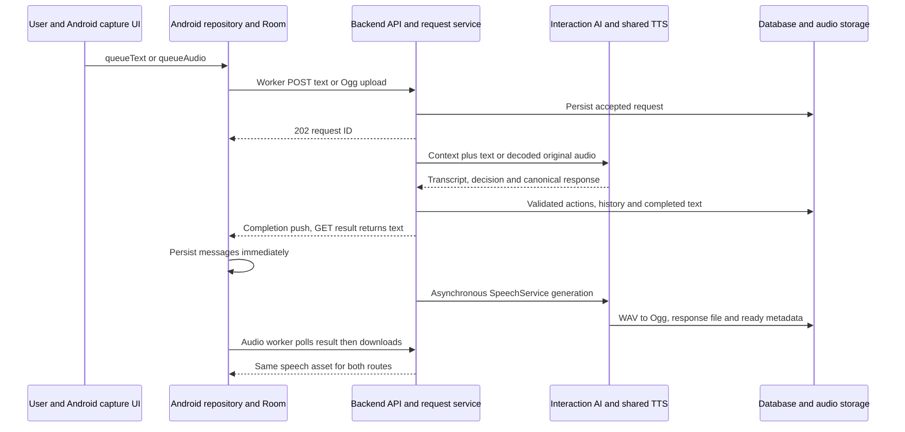
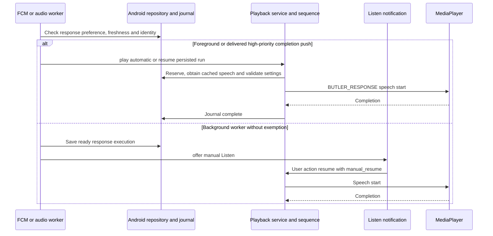
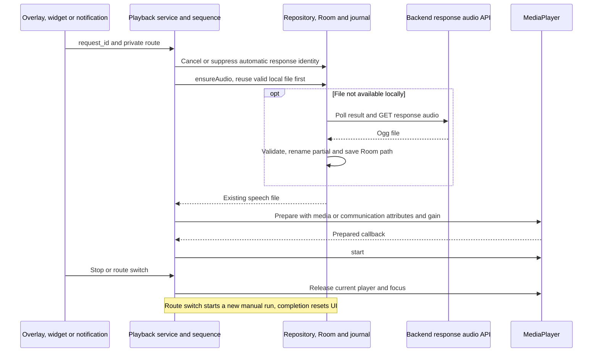
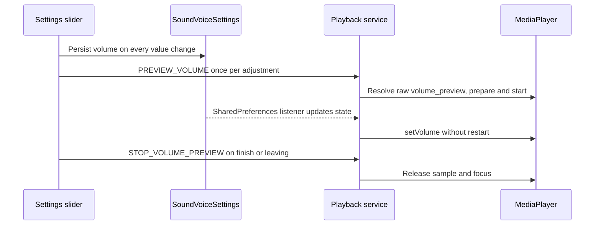

# Audio flow trace — Phase 2

**Status:** Source of Truth. Source code is authoritative. Phase 2 extends existing Room, repository, WorkManager, scheduler, journal and shared player, without another audio identity or database.

## Entry points

| Event | Canonical text / creation | Preparation | Playback |
| --- | --- | --- | --- |
| Morning Brief | `planning.service` persists generated briefing with plan | Shared backend speech and canonical client reconciliation | Existing Morning Brief workflow |
| Good Night Summary | `planning.evening` persists generated summary | Same preparation lifecycle | Existing Good Night workflow |
| Reminder from an order | Butler daily-event mutation persists immediately | Starts after canonical sync, independent of nightly planning | Existing Reminder workflow |
| Other supported speech-enabled events | Planning/event mutation/sync | Same event/version API and WorkManager mechanism | Existing event-to-workflow mapping |
| Manual brief Listen | Existing Room text | Prefer prepared speech; recovery only at speech step | Shared service and configured workflow in explicit manual mode |
| Butler Response | Existing request/result text | Existing response audio path | Existing response workflow; no native fallback added |

Generated briefs begin directly with substantive content; Android supplies prerecorded greetings. Actual provider prompts and draft validators enforce that split. Backend TTS and the existing profile/credit policy remain preferred.

## Early preparation and durable publication

`DailyEventRepository` commits canonical events to Room, reconciles alarms, and independently enqueues `DailyEventAudioWorker`. Local unsynchronized edits schedule immediately but cannot fetch speech until confirmation. Reminders created by orders are eligible immediately after sync, not only through nightly planning.

WorkManager uses CONNECTED constraints, unique event/version KEEP work and exponential backoff. Pending/processing TTS, unavailable files, network and temporary server failures retry. Stale versions request synchronization; deleted, unsupported/ineligible and authentication-rejected requests terminate. Startup/restoration repairs missed enqueueing from Room. A playback attempt no longer stops preparation during a workflow delay. Workers never invoke playback.

`speechAudio(id, version)` uses shared preparation POST and versioned GET, checking canonical backend version, `X-Event-Version`, Ogg/Opus container and current Room/pending-edit state before atomic publication to `filesDir/event_speech/{id}-{version}.ogg`. Changed/obsolete transfers are discarded. Backend status distinctions remain 202 pending, 409 stale, 404 missing, 410 deleted, 422 ineligible, 424 unavailable and temporary server failure. Narration uses nonblank content → description → title.

## Alarm and speech-step resolution

`DailyEventScheduler` binds version and computed trigger time to alarm intents. `DailyEventAlarmReceiver` reads Room, rejects obsolete registration via `matchesAlarm()`, posts event text and respects current automatic preferences/Android launch restrictions. Background workers offer Listen when starting a service is prohibited.

`ButlerAudioPlaybackService.prepare()` claims an automatic occurrence independently of readiness. Automatic journal identity remains event/version; manual brief runs are explicit repeatable executions and suppress competing automatic playback. Canceled/skipped events never speak; manual runs may use completed/historical/future briefs. An attempt is not successful speech completion.

`AudioSequence` executes the unchanged definition snapshot and warm-up rotation. Good Night retains its existing long opening. DELAY commits the next operation/due time, then releases service/player/focus; exact alarms and WorkManager restore continuation. Ambiguous process death during an audible segment cancels the run instead of repeating it.

Only at PLAY(<speech>) does `SpeechSourceResolver` choose:

1. Valid protected/prepared local speech. `snapshotPreparedSpeech()` copies atomically into `filesDir/workflow_audio/{id}-{version}.ogg`. Ready speech needs no backend call or auth refresh.
2. One online recovery attempt, at most five seconds, joining existing repository preparation when possible. An absolute deadline also covers blocking streaming reads, not just suspending network calls. Pending, unavailable, timeout or network failure moves on; there is no live polling loop.
3. Offline Android native TTS as the final source. Late background downloads never trigger another playback.

A file failure before audible start invalidates the unusable source and allows fallback. Failure/interruption after audible start ends the run rather than replaying its beginning through a second source. Unavailable speech restores normal event text/sound and cancels the journal, without reporting success.

## Native fallback and single audible owner

`LocalTextToSpeech.renderOffline()` checks initialization, installed nonnetwork voice data and language availability. It synthesizes temporary WAV files only; the same shared MediaPlayer supplies Butler gain, routing, focus, Stop and settings handling. There is no independent dialog/native audible player. Engine initialization and synthesis are bounded to fifteen seconds per Android-sized chunk. Chunks preserve all text and UTF-16 pairs. Cancellation shuts down synthesis and temporary files are removed.

`BriefContentDialog` delegates to `playEvent(automatic=false)` and observes `ButlerPlayback.eventId`; closing cancels a run it initiated. Conversation response source/retry policy remains unchanged, with shared player-start robustness improvements.

## Edits, version safety and cleanup

- Alarm version/trigger binding rejects obsolete alarms after rescheduling.
- Executions snapshot text, trigger time, type and speech eligibility. `matchesExecution()` checks current state before continuation and player start; Room observation cancels incompatible active edits.
- Exact canonical confirmation of a local edit (one version increment, matching scheduled date/time, text/type/eligibility and no known voice change) may rebind validated local bytes. A local timing edit retains compatible bytes while unsynchronized but cannot consume them until confirmation.
- Other remote version changes download version-validated audio: unchanged text alone cannot prove unchanged TTS settings. Backend reuse still avoids unnecessary generation.
- Literal own-clock references in otherwise unchanged ordinary-event narration are retimed before invalidation. Brief summaries retain their content when their delivery time moves. General semantic/multilingual time rewriting requires an explicit narration edit.
- Profile TTS-method changes increment eligible planned event versions and invalidate backend speech. Client settings reconciliation cancels event runs, clears prepared files, queues canonical sync and blocks old protected identities until new versions arrive. Deployment voice/model changes outside the editable TTS method are not automatically fingerprinted.
- Obsolete/deleted prepared files are cleaned separately from protected player snapshots. Terminal journals are retained for seven days; pruning preserves files referenced by active runs. Logout stops workflows and clears local audio.

## Temporal consistency

Actual interaction and planning prompts receive supplied aware local datetime/timezone and shared temporal instructions. `normalize_context_period()` guards Butler context actions, direct Notes & Preferences saves and Upcoming rule mutations for all context types.

Known relative dates/times and English calendar ranges become absolute dates with years. N days includes its starting date; a one-boundary edit preserves established nonrecurring duration. Recurrence stays a rule, temporary preferences retain dates, and notes/preferences stay nonactionable. Existing resolved dates and direct-save retries keep their original anchor. Ambiguous or contradictory supported forms reject persistence. No general language parser, blind old-record rewrite or schema migration is introduced; broader language resolution remains the model's responsibility.

`editable_context` exposes latest nondeleted future/past/note entries for retrieval/mutation separately from active planning input. Prompts prohibit using those extra targets as automatic personalization. Actual brief prompts request substantive openings; draft validators remove known redundant greeting prefixes.

## Source map

| Concern | Source / methods |
| --- | --- |
| Publication, reuse, claim | [DailyEventRepository.kt](../../../client/app/src/main/java/com/hellobutler/app/data/repository/DailyEventRepository.kt): `speechAudio`, `recoverSpeech`, `reconcileAudio`, `claimEventPlayback`, `snapshotPreparedSpeech`, `reconcileTtsMethod` |
| Preparation/retry | [DailyEventAudioWorker.kt](../../../client/app/src/main/java/com/hellobutler/app/execution/DailyEventAudioWorker.kt): `doWork`, `canPrepareSpeech` |
| Alarm binding | [DailyEventScheduler.kt](../../../client/app/src/main/java/com/hellobutler/app/execution/DailyEventScheduler.kt), [DailyEventExecution.kt](../../../client/app/src/main/java/com/hellobutler/app/execution/DailyEventExecution.kt) |
| Audible owner | [ButlerAudioPlaybackService.kt](../../../client/app/src/main/java/com/hellobutler/app/execution/ButlerAudioPlaybackService.kt): `prepare`, `speakEvent`, `playResource`, `matchesExecution`, `cancelEvent` |
| Source choice | [SpeechSourceResolver.kt](../../../client/app/src/main/java/com/hellobutler/app/execution/audio/SpeechSourceResolver.kt): `speak` |
| Offline synthesis | [LocalTextToSpeech.kt](../../../client/app/src/main/java/com/hellobutler/app/execution/LocalTextToSpeech.kt): `renderOffline`, `nativeSpeechChunks` |
| Delayed journal | [AudioWorkflowScheduler.kt](../../../client/app/src/main/java/com/hellobutler/app/execution/audio/AudioWorkflowScheduler.kt), [AudioWorkflowStore.kt](../../../client/app/src/main/java/com/hellobutler/app/execution/audio/AudioWorkflowStore.kt) |
| Backend invalidation | [speech.py](../../../backend/app/application/speech.py), [changes.py](../../../backend/app/application/push/changes.py), [user_settings.py](../../../backend/app/application/user_settings.py) |
| Actual prompts | [prompts.py](../../../backend/app/infrastructure/ai/prompts.py), [planning/contracts.py](../../../backend/app/application/planning/contracts.py) |
| Stable context | [context_temporal.py](../../../backend/app/application/context_temporal.py), Butler `actions/user_context.py`, `user_settings.py`, `upcoming.py` |

## Tests and device acceptance

Backend regressions cover actual prompt calls, greeting removal, local datetime/year resolution, every supported context type, midnight rollover, duration-preserving edits, recurrence, temporary preferences, ambiguity/contradiction, retry anchors, future mutation targets, literal-time invalidation and TTS-method versions. Android unit tests cover prepared preference, single recovery/timeout, offline/native failure, cancellation, late files, partial speech, stale alarms/executions, chunks and existing sequence/gain/preferences/delay behavior. Instrumentation sources cover durable storage/restart, concurrent transfer/edit races, compatible local reuse, rejection of unproven remote voice bytes, protected snapshot invalidation, stalled-stream deadlines and active-file retention. An offline installed-voice test validates synthesized output using Android's decoder.

Verification on 2026-10-13: 79 backend tests and 21 Android unit tests passed. Ruff lint/format and Pyright passed. Debug assembly, instrumentation-test compilation and Android lint passed (zero errors; existing warnings remain). The equivalent LineBreaker constant fixes the pre-existing widget lint annotation error without changing its value/behavior. No device is attached, so instrumentation tests and audible/installed-engine acceptance have not run. Live LLM and deployed TTS providers were not exercised.

Device acceptance: prepare all event categories, disable networking and backend, restart, clear temporary cache and trigger alarms. Valid prepared speech must issue zero event HTTP calls and preserve configured sequences. Repeat missing speech with an installed offline voice, missing voice, pending/timeout backend, Stop/focus loss, setting changes and rescheduling during delay/render/player preparation. Check actual Butler gain, system volume isolation, notification permissions/DND and locked-device/OEM delivery. Instrumentation compilation and injected playback tests do not prove audible output or installed-engine behavior; live LLM wording and deployed providers require separate verification.

The following response and asset/capture traces are retained from Phase 1. Their entry points and configurations remain unchanged.

## Unchanged Butler Response trace

### Input/text/audio preparation diagram

### Automatic listening diagram

### Manual speaker/private listening diagram

### Numbered execution trace

1. **Entry/input:** [MainScreen.kt](../../../client/app/src/main/java/com/hellobutler/app/ui/main/MainScreen.kt), local `startCapture()` permission-checks RECORD_AUDIO, delays capture cue start, calls [ButlerAudioRecorder.kt](../../../client/app/src/main/java/com/hellobutler/app/speech/ButlerAudioRecorder.kt) `start()` (MIC, OGG/OPUS, 32 kbps, 16 kHz), then beeps. `finishCapture()` discards <1000 ms recordings using `shouldDiscardVoiceCapture()`, otherwise calls `MainViewModel.finishRecording(recorder.stop())`. [MainViewModel.kt](../../../client/app/src/main/java/com/hellobutler/app/ui/main/MainViewModel.kt) maps Order/Talk to `ButlerRepository.queueAudio()`. `sendText()→queueText()` skips recording and STT. `queueAudio()` validates Ogg, moves file to `butler_pending`, stores request/user placeholder in Room; both queues use client UUID for retry identity and enqueue upload work.
2. **Upload and understanding:** [ButlerRequestWorkers.kt](../../../client/app/src/main/java/com/hellobutler/app/sync/ButlerRequestWorkers.kt), `ButlerRequestWorker.doWork()→ButlerRepository.upload()` flushes local event edits first, posts multipart or JSON through [ButlerApi.kt](../../../client/app/src/main/java/com/hellobutler/app/data/remote/ButlerApi.kt), marks sent, enqueues result worker. [api/butler.py](../../../backend/app/api/butler.py), `create_audio_request()` validates MIME/size/Ogg signature and stores input; `create_text_request()` accepts text. `ButlerRequestService.accept_*()` persists idempotent accepted owner, API returns 202 and `BackgroundTasks` calls `process()`. [requests.py](../../../backend/app/application/butler/requests.py), `process()` claims request, sends handling push, charges reasoning once, calls `ButlerService.handle()`.
3. **Canonical text:** [service.py](../../../backend/app/application/butler/service.py), `handle()→compiled ButlerGraph.ainvoke()`; [graph.py](../../../backend/app/application/butler/graph.py) `_load_context()→_interaction()→_route()→_apply_action()` or `_complete_without_mutation()→_save_history()`. [context.py](../../../backend/app/application/butler/context.py), `ButlerContextLoader.load()` reads recent conversation/context/relevant events. `OpenAIButlerProvider.interact()` converts original Ogg to validated 16 kHz mono WAV using `_wav_audio()`/FFmpeg, embeds base64 `input_audio`, and uses audio model; text uses text model. `_chat_interaction()` calls Chat Completions with `BUTLER_INTERACTION_INSTRUCTIONS` and forced structured interaction tool. Returned `user_message_text` is the understood transcript; **no separate transcription endpoint or transcript-only reasoning call**. Canonical `response_text` comes from proposal, validated state/action result; [history.py](../../../backend/app/application/butler/history.py), `ButlerHistoryWriter.save()` saves user/Butler conversation rows. `_complete()` stores canonical response/transcript/changes, status completed, audio pending (or unavailable when voice disabled).
4. **TTS and persistence:** `process()` deletes temporary input after success, publishes completion, and finally launches `SpeechService.generate("request",id)` as an asyncio task. Shared §2 policy generates response Ogg and metadata independently; result exposes audio URL only when ready/path present. `ButlerRepository.reconcile()` polls `GET /api/butler/requests/{id}`, `persistCompleted()` transactionally upserts both messages and completed request, retains valid local cached audio, deletes pending input, shows response notification if background, enqueues `ButlerAudioWorker` for pending/processing/ready speech, synchronizes changed events/context. Result/upload/audio workers use network constraint, named unique work and exponential backoff starting 10 seconds.
5. **Audio retrieval and automatic trigger:** `ensureAudio()` serializes downloads per request ID; first reuses valid existing local audio, otherwise polls result when no URL and pending, maps unavailable status, downloads authenticated `/{id}/audio`, validates/stages file, updates Room cached/path/duration. `ButlerAudioWorker.doWork()` returns retry until file or unavailable. With responses enabled and message completed in last ten minutes, no existing automatic journal, it saves ready `response:{id}` then resumes if foreground, offers otherwise. FCM `onMessageReceived()` may call `play(automatic=true)` **before reconcile**, if responses enabled and foreground or delivered priority high; service `prepare()` requires an existing Room request, so first-time push/reconcile ordering matters. Worker is the later reconciliation path. Direct automatic `prepare()` also checks original request age ≤10 minutes and reserves preparing; worker checks message completion age.
6. **Manual trigger and selection:** [ButlerOverlay.kt](../../../client/app/src/main/java/com/hellobutler/app/ui/main/ButlerOverlay.kt) playback callbacks wired in `MainScreen` call `play(requestId,private)` or Stop. Widget and notifications use shared response intents. Manual `prepare()` cancels existing `response:{id}` or writes cancelled suppression marker before downloading, then journals UUID run, `BUTLER_RESPONSE`, desired route. Auto preference does not gate manual response playback. `ensureAudio()` polling in service ends after 120 seconds or unavailable. No TTS regeneration API is called when expired response audio is missing.
7. **Playback:** `AudioSequence.run()` executes only `<speech>` for `BUTLER_RESPONSE`; `playResource()` uses the same file for speaker/private attributes. Starting opposite route releases/cancels active owner then starts replacement. `ButlerPlayback` LOADING/SPEAKING drives overlay/widget; negative focus, Stop, timeout, errors and replacement end current ownership. No response opening chime.
8. **Completion/cleanup:** `AudioSequence` completes journal; service resets UI and removes playback notification. Local response file stays reusable even after backend retention; logout removes it. `ButlerRepository.recover()` enqueues recoverable uploads/results and `refreshHistory()` rebuilds Room from recent server responses (last five with audio states enqueue audio workers). Historical automatic speech still passes worker/service freshness checks; no old-history announcement guarantee is inferred beyond those checks.

## Unchanged calibration, assets and capture cue trace

### Calibration diagram

### Volume calibration numbered trace

1. **Entry:** [ui/settings/SoundVoiceSection.kt](../../../client/app/src/main/java/com/hellobutler/app/ui/settings/SoundVoiceSection.kt), `SoundVoiceSection()` Slider `onValueChange` → `settings.volume()`; first change while `adjusting=false` → `ButlerAudioPlaybackService.preview()`.
2. **Text source:** Bundled prerecorded sample, not current response or AI prompt. No text processing.
3. **Generation:** No runtime TTS/provider/credits. `preview()` sends `ACTION_PREVIEW` (`com.hellobutler.app.PREVIEW_VOLUME`). A launch exception is swallowed by UI `runCatching`.
4. **Storage:** `AudioResources` resolves `R.raw.volume_preview`; packaged MP3 is copy of `morning_warmup_0.mp3`, not downloaded speech. No new journal/file.
5. **Scheduling:** Service ignores preview while another active owner exists. Otherwise service foreground setup invokes `playResource("volume_preview","")` directly. One start per slider adjustment; no WorkManager, looping, or sequence checkpoint.
6. **Workflow selection:** Preview **bypasses AudioSequence but reuses its player implementation**. Does not consume warm-up rotation; direct `volume_preview` resource.
7. **Playback:** Shared MediaPlayer media usage/gain/focus; state collector updates current gain. The sample plays once and can finish before a long slider adjustment ends; it is not looped continuously. Missing/error sample ends without synthesis.
8. **Completion:** Natural completion finishes service. `onValueChangeFinished` or adjusting composable disposal sends `STOP_VOLUME_PREVIEW`; handler only finishes when preview is current owner. Sample cleanup uses shared release/reset; volume persists in `butler_sound_voice`.

### Bundled openings and greetings numbered trace

1. **Entry:** `AudioSequence.run()` sees `AudioStep.Play(resource)` from selected definition; no separate user/API trigger.
2. **Text:** Prerecorded MP3 content; source code does not establish which external tool/provider originally recorded these assets, so no provenance is inferred.
3. **Generation:** None at runtime; does not call `SpeechService` or Android TTS.
4. **Storage:** APK `client/app/src/main/res/raw` has long/short openings, five morning warm-ups, five evening warm-ups, preview. Runtime mapping in [AudioResources.kt](../../../client/app/src/main/java/com/hellobutler/app/execution/audio/AudioResources.kt).
5. **Scheduling:** Parent sequence order/checkpoint determines when a resource starts; warm-up must finish before Morning Brief delay clock begins.
6. **Selection:** `AudioResources.resolve()` → `AudioWorkflowStore.select(group)` for named group → `nextRotation()` shuffled remaining list. Separate persistent queues; no repeat within a valid five-item group cycle. Selection persisted before output; crash can consume selection without sound.
7. **Playback:** `resources.openRawResourceFd()` descriptor → shared `MediaPlayer.setDataSource(fd,offset,length)` → prepare/start with Butler gain. Optional failure is logged/skipped; speech failure cancels parent.
8. **Completion:** Releases player, parent advances index. Bundled assets are never deleted; only journal/rotation state is reset/pruned as described earlier.

### Voice capture and cue numbered trace

1. **Entry:** Order/Talk press capture, or widget Talk opening resumed app capture, calls MainScreen local `startCapture()`. Microphone permission and no active/pending recording gate it; pending start cancelled on early release.
2. **Text:** Microphone contains user speech; canonical text only appears after backend multimodal interaction (response trace above). Text composition bypasses this flow.
3. **Generation/capture:** `ButlerAudioRecorder.start()` requires Android 10+ and creates Ogg/Opus via MediaRecorder. After successful start MainScreen invokes `listeningTone.startTone(TONE_PROP_BEEP,LISTENING_CUE_DURATION_MILLIS)` using `ToneGenerator(STREAM_NOTIFICATION,45)`. This cue is algorithmic, not TTS.
4. **Storage:** Capture in cache, queued upload moved into `filesDir/butler_pending`, backend temporary inputs; decoded WAV kept in memory. No user-recording playback UI/player in inspected sources.
5. **Scheduling:** UI delayed coroutine then WorkManager upload/result/audio phases; short capture <1000 ms discarded, `stop()` catches MediaRecorder RuntimeException/deletes invalid file; disposal/cancel stops/releases recorder and deletes temporary output. Widget tap-talk cancels on background/overlay exit.
6. **Selection:** No audio workflow during capture/cue; Order/Talk only changes interaction mode. Both use the same backend graph.
7. **Player:** Recorder is an input engine; ToneGenerator is the audible cue. Cue **bypasses shared workflow and Butler player gain**, controlled by fixed generator gain and Android notification stream.
8. **Completion:** `finishCapture()→MainViewModel.finishRecording()→queueAudio()` starts durable request lifecycle; reconcile deletes queued recording after completion. ToneGenerator is released on MainScreen disposal; backend failure retention remains owned by the response repository.

### Android notification sounds

`DeferredSpeechNotification` and `ButlerNotification` create DEFAULT-importance channels; playback/waiting channels are LOW. No explicit `setSound(customAsset)` or independent reminder-alarm sound sequence exists in these builders. Audible notification sounds depend on Android channel/user/DND configuration and channel creation history, and bypass Butler gain. Creating a channel again does not prove its importance or sound changed. This is distinct from the short opening played after reminder speech preparation.
