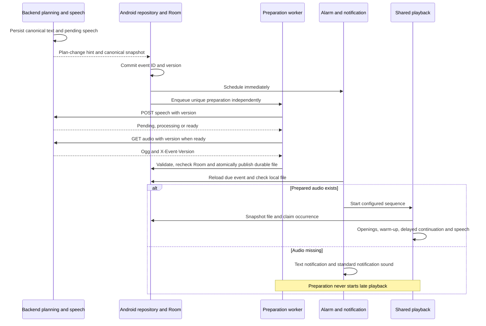
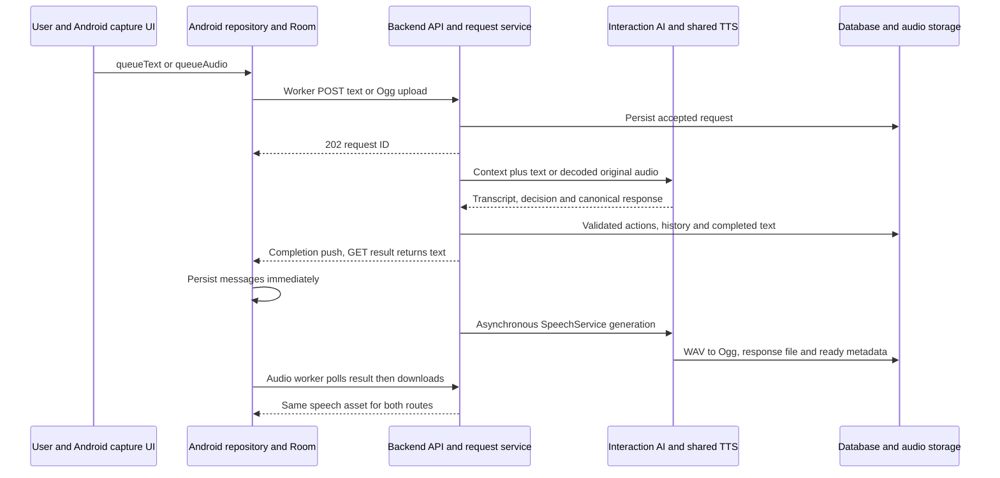
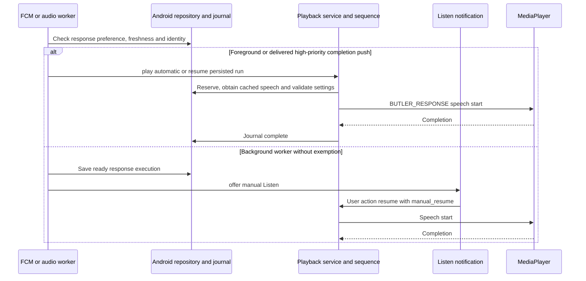
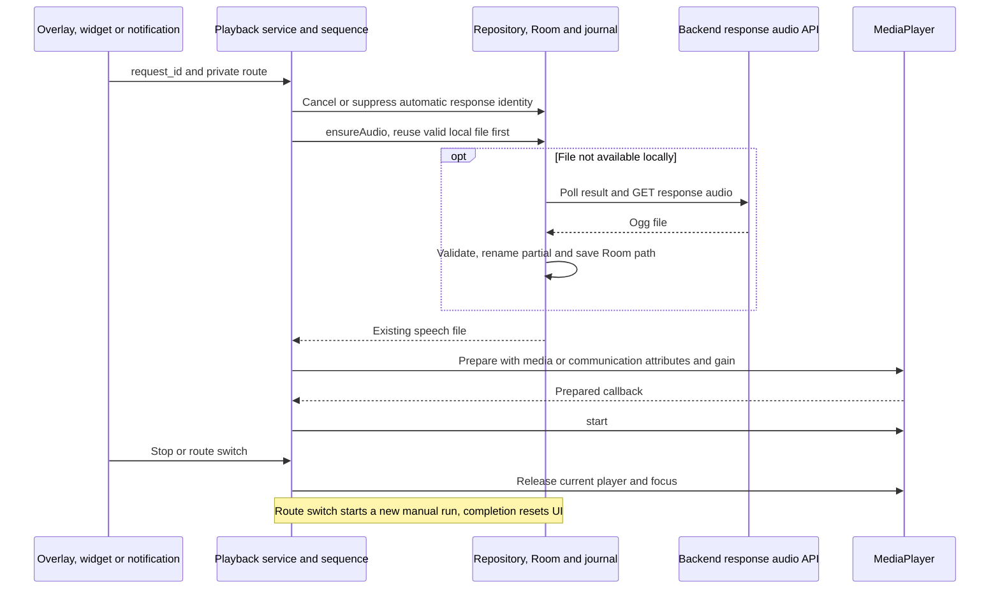
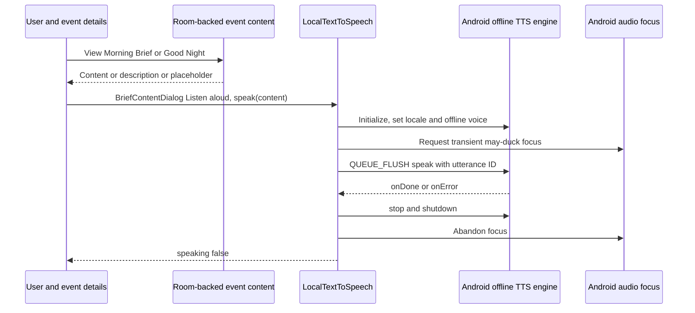
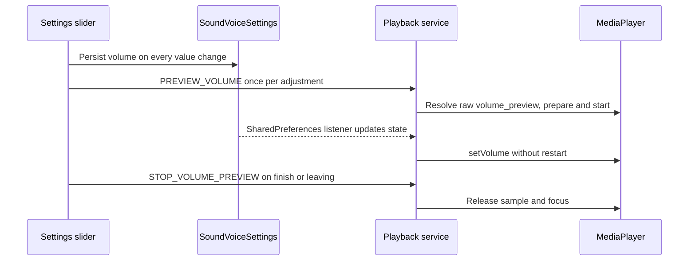

# Audio Flow Trace — Current Implementation

**Parent:** [PROJECT_CLIENT.md](PROJECT_CLIENT.md)  
**Configuration contract:** [AUDIO_WORKFLOWS.md](AUDIO_WORKFLOWS.md)  
**Backend speech contract:** [TTS.md](../backend/TTS.md)  
**Implementation baseline:** `docs/audio-flow-trace`, offline-first scheduled-event preparation, 2026-10-12. Conversation-response and manual native-TTS paths remain independently traced below.

This is a source-derived execution/debugging reference, not a claim that every path has passed device testing. Source code describes current behavior; [PROJECT.md](../PROJECT.md) describes intended product behavior. Differences are recorded below without changing those requirements. Defaults are code defaults, not verified deployment environment values. Paths are relative to repository root and linked for navigation. Android data directories are expressed using actual `Context.filesDir`/`cacheDir` code, rather than assuming a package installation path.

## 1. Overview

| Flow | Trigger | Text source | TTS provider | Audio storage | Scheduler | Actual player |
| --- | --- | --- | --- | --- | --- | --- |
| Morning Brief, scheduled | Future Room event alarm; fallback Listen notification | Planning AI `MorningBriefDraft.content` | Shared backend OpenAI/Kokoro | Backend `events`; Android durable `filesDir/event_speech` → protected `workflow_audio` snapshot | AlarmManager initially; WorkManager + optional exact alarm after delay | `ButlerAudioPlaybackService.playResource()` → `MediaPlayer.start()` |
| Good Night Summary, scheduled | Future Room event alarm; fallback Listen | Evening AI `GoodNightSummaryDraft.content`, or protected user-authored summary | Shared backend OpenAI/Kokoro | Same event stores | AlarmManager / initial notification worker; no configured delay | Shared service → MediaPlayer |
| Butler response, automatic | Completion FCM or audio worker, preference and freshness gated | Multimodal/text interaction AI canonical response | Shared backend OpenAI/Kokoro | Backend `responses`; Android durable `butler_audio`; Room file reference | Upload/result/audio WorkManager; FCM; continuation offer/recovery | Shared service → MediaPlayer |
| Butler response, manual speaker/private | Overlay, widget, response notification | Same persisted response | Reuses same backend asset; no Android synthesis | Same response stores | User foreground-service intent; loading polls | Shared service → MediaPlayer with media/communication route |
| Reminder | Alarm or scheduled Listen action | Event `content` → `description` → `title`; no separate reminder-script AI call | Shared backend, queued after canonical persistence | Backend `events`; durable prepared files → workflow snapshot | AlarmManager or WorkManager notification fallback | Shared service → short opening + MediaPlayer speech |
| Brief details, manual Listen aloud | `BriefContentDialog` button | Room content → description → placeholder | **Android offline native TTS** | Native engine output; no app speech file | Compose coroutine; no workflow journal | `LocalTextToSpeech.speak()` → `TextToSpeech.speak()` |
| Volume calibration | Settings slider value changes | Prerecorded sample | None at runtime | Bundled `res/raw/volume_preview.mp3` | No sequence/delay; one service invocation | Shared `playResource()` → MediaPlayer, **bypasses AudioSequence** |
| Opening/warm-up assets | Sequence `PLAY` operation | Prerecorded sound/speech | None at runtime | Bundled `res/raw/*.mp3` | Inside selected workflow | Shared MediaPlayer |
| Voice input | Order/Talk capture; widget Talk opens app capture | User microphone; multimodal AI returns understood transcript | No TTS for input | Recording cache → pending files → backend inputs; temporary WAV in memory | Capture coroutine; upload/result workers | MediaRecorder for capture; no input playback |
| Recording cue | Successful recorder start | Synthesized beep, no text | None | None | MainScreen capture coroutine | `ToneGenerator.startTone()` on notification stream |
| Notification channel sound | Android notification delivery, if channel/user settings permit | None | None | System/user notification sound | Android notification system | Android system player; separate from Butler speech |

**Fast debugging distinction:** Clicking **View Morning Brief → Listen aloud** follows native Android TTS. Waiting for its event alarm follows `AudioSequence`. Conversation **Listen Aloud / Phone Listen**, widget playback, and response-notification playback follow the shared service. There is no general manual speech button for ordinary Daily Event details in this baseline.

## 2. Shared backend generation, readiness, and storage

### 2.1 Provider and lifecycle trace

1. [backend/app/core/lifecycle.py](../../../backend/app/core/lifecycle.py), `speech_service()` constructs `SpeechService` with `OpenAIButlerVoiceProvider` and `KokoroButlerVoiceProvider`, using settings, not provider-constructor fallback defaults.
2. [backend/app/application/speech.py](../../../backend/app/application/speech.py), `SpeechService.pending()` finds completed requests or planned/nondeleted eligible events with `pending` or stale `processing` audio. All event types with speech enabled and nonblank narration are supported; reminders are eligible regardless of that flag. `generate(kind, owner_id)` locks the owner row, rechecks eligibility, snapshots text/event version, and changes audio status to `processing` before synthesis.
3. `generate()` uses request `response_text` or event `event_speech_text()`: first nonblank content → description → title, trimmed. Empty narration or disabled backend voice yields unavailable speech.
4. `_choose()` locks the owner and `users` row. Non-`OPENAI` preference selects Kokoro. OpenAI selection falls back to Kokoro when credits are below configured cost or the OpenAI provider is absent. A nonzero cost is deducted and `tts_credit_charged=true` reserves it. A previously charged owner selects OpenAI without another deduction. Stored `tts_method` is unchanged. Reasoning/planning credits are separate and do not receive this speech fallback.
5. [backend/app/infrastructure/ai/openai_provider.py](../../../backend/app/infrastructure/ai/openai_provider.py), `OpenAIButlerVoiceProvider.synthesize()` calls `AsyncOpenAI.audio.speech.create(model, voice, input=text, response_format="wav")` and validates RIFF/WAVE. [backend/app/infrastructure/ai/kokoro_provider.py](../../../backend/app/infrastructure/ai/kokoro_provider.py), `synthesize()` serializes inference with its instance lock and runs `_render_wav()` in a thread; lazily loads `KPipeline`, concatenates audio chunks, and writes 24 kHz PCM16 WAV into memory. Kokoro is **backend-local**, not Android-local.
6. `SpeechService._store()` validates WAV, runs FFmpeg `libopus`, 32 kbps/VBR with metadata stripped, checks Ogg/Opus signatures, and publishes the generated `.ogg` with a unique partial file and atomic replace. WAV is an intermediate byte buffer, not the persisted speech format.
7. OpenAI synthesis/encoding/storage exceptions are logged, reserved credits refunded through `_refund()`, and Kokoro attempted once. Kokoro failure or no provider ends as `unavailable`. Cancellation refunds and returns the owner to `pending`. Event preparation retries unavailable/expired speech through the shared preparation endpoint; WorkManager applies backoff. No playback-time retry is used for events. SDK retry details are external to this application's call chain.
8. `generate()` finally locks the owner again. A changed event version discards the new file instead of publishing it and refunds an obsolete OpenAI reservation without clearing the newer version’s reservation. Otherwise it stores `audio_status=ready|unavailable`, path, `audio/ogg`, and deletion deadline. Generation does not mark a Daily Event completed. Text completion remains independent.
9. [backend/app/main.py](../../../backend/app/main.py), `lifespan()` starts `maintain_butler_requests()`: recover requests, create tasks for `speech.pending()`, then run request/event cleanup every configured maintenance interval (default 60 seconds). Row state claims avoid normal duplicate synthesis; stale processing recovery depends on `updated_at` (default stale interval 10 minutes). These are asyncio tasks in the backend process, not an external job queue. The maintenance coroutine catches/logs failures and continues.

[backend/app/core/config.py](../../../backend/app/core/config.py), `Settings` defaults: text/planning `gpt-5.4-nano`, audio understanding `gpt-audio-1.5`, TTS `gpt-4o-mini-tts`, OpenAI voice `fable`, Kokoro language `b`/voice `bm_fable`, TTS credit cost 1, voice enabled, audio retention 1 day. Environment overrides may change all of these.

### 2.2 Storage inventory and ownership

| Storage | Actual path / metadata | Writer → reader | Retention, invalidation, cleanup |
| --- | --- | --- | --- |
| Backend uploaded input | `Path(settings.butler_audio_root)/inputs/{request_id}-{random_uuid}.ogg` | `create_audio_request()` → `ButlerRequestService.process()` → AI decoder | Success deletes/clears path; failure retains to deadline (default 24 hours), maintenance retries cleanup; validation/duplicate upload removes its temporary copy |
| Backend response speech | `{butler_audio_root}/responses/{request_id}.ogg` | `SpeechService._store("request",…)` → authenticated `get_response_audio()` | Request metadata holds path/MIME/status/deadline; `ButlerRequestService.cleanup_audio()` deletes expired input/response files, sets response unavailable; canonical text remains |
| Backend event speech | `{butler_audio_root}/events/{event_id}-{version}.ogg` | `_store("event",…)` → authenticated `event_audio()` | `SpeechService.cleanup_audio()` expires referenced files and old orphan `.ogg` files by mtime; invalidation generally clears metadata, with old file left to orphan cleanup |
| Backend database | `butler_requests`, `daily_events` audio columns; `conversation_messages.content`; `users.credits`, `users.tts_method` | Application services → APIs | DB stores text and references, not audio blobs. Models: [conversation.py](../../../backend/app/infrastructure/db/models/conversation.py), [planning.py](../../../backend/app/infrastructure/db/models/planning.py), [user.py](../../../backend/app/infrastructure/db/models/user.py) |
| Android input capture | `File(context.cacheDir,"butler-input-{uuid}.ogg")` | `ButlerAudioRecorder.start()` → `stop()` → `queueAudio()` | Cancel/invalid short capture deletes; successful queue moves/copies to pending directory |
| Android pending upload | `File(context.filesDir,"butler_pending")/{request_id}.ogg` | `ButlerRepository.queueAudio()` → `upload()` | Room request `localAudioPath` references file until reconcile completion; then deleted; logout clears directory |
| Android response speech | `File(context.filesDir,"butler_audio")/{request_id}.{extension}`; download uses `.part` | `ButlerRepository.ensureAudio()` → shared player | Durable internal files, Room message path/cache state; same-request files replaced on redownload; no age-based pruning observed; logout deletes directory. Supports signature checks for Ogg, WAV, MP3, M4A, though shared backend currently produces Ogg |
| Android prepared event speech | `File(context.filesDir,"event_speech")/{event_id}-{version}.ogg`; unique `.part` during transfer | `DailyEventAudioWorker` → `DailyEventRepository.speechAudio()` → local-only lookup | Durable internal files; header/version validated; obsolete/deleted/ineligible files pruned after persistence and startup; stale partials older than a day removed; logout clears |
| Android event workflow copy | `File(filesDir,"workflow_audio")/{event_id}-{version}.ogg` | `DailyEventRepository.claimPreparedSpeech()` copies prepared speech → journal/player | Durable for delay/process death; terminal event runs older than 7 days pruned by `AudioWorkflowStore.prune()` at recovery; logout clears directory. Prepared directory cleanup never touches active/delayed workflow snapshots |
| Android workflow journal | SharedPreferences `butler_audio_workflows`, keys `execution:{id}`, `rotation:{group}` | `AudioWorkflowStore.save()/select()` → service/scheduler/recovery | JSON snapshot: ID, workflow/definition, file path, owner/version, next index, due time, mode/route, status/timestamps. `save()` uses synchronous `commit()`; terminal runs pruned after 7 days; logout clears |
| Android sound preferences | SharedPreferences `butler_sound_voice`: `volume`, `reminders`, `responses`, `briefings` | `SoundVoiceSettings.volume()/toggle()` → service/workers/receivers | Device-local; defaults 70%, off, off, on. Logout path does not clear these settings |
| Android Room | `daily_events.playbackAttemptedAt`; `butler_requests`; `conversation_messages.localAudioPath/audioCacheState` | Repositories/DAO → UI, workers, service | [DailyEventEntity.kt](../../../client/app/src/main/java/com/hellobutler/app/data/local/DailyEventEntity.kt) contains no generated audio file path/status; response file refs live in [ButlerConversation.kt](../../../client/app/src/main/java/com/hellobutler/app/data/local/ButlerConversation.kt) |
| Bundled assets | `client/app/src/main/res/raw/{long_opening,short_opening,volume_preview}.mp3`; `morning_warmup_0…4.mp3`; `evening_warmup_0…4.mp3` | APK resources → `AudioResources.resolve()` → raw descriptor | Packaged recordings, not runtime TTS/cache; no backend download. Preview matches morning warm-up 0 byte-for-byte in this baseline |

`butler_audio_root` defaults to `data/butler_audio`, relative to backend process working directory. Do not assume a particular host/container mount. Event and response API downloads use authenticated owner queries; client repositories refresh authentication once after 401.

### 2.3 Shared Android execution and playback trace

Sources: [ButlerAudioPlaybackService.kt](../../../client/app/src/main/java/com/hellobutler/app/execution/ButlerAudioPlaybackService.kt), [AudioSequence.kt](../../../client/app/src/main/java/com/hellobutler/app/execution/audio/AudioSequence.kt), [AudioWorkflow.kt](../../../client/app/src/main/java/com/hellobutler/app/execution/audio/AudioWorkflow.kt), [AudioResources.kt](../../../client/app/src/main/java/com/hellobutler/app/execution/audio/AudioResources.kt), [AudioWorkflowStore.kt](../../../client/app/src/main/java/com/hellobutler/app/execution/audio/AudioWorkflowStore.kt), [AudioWorkflowScheduler.kt](../../../client/app/src/main/java/com/hellobutler/app/execution/audio/AudioWorkflowScheduler.kt).

1. Service companion `play()/playEvent()/resume()` invokes `ContextCompat.startForegroundService()`. `onStartCommand()` reads `request_id`, `daily_event_id`, `execution_id`, `private`, `automatic`, `manual_resume`. It rejects terminal/future continuations, stale automatic responses, duplicate active owner/route, or preview while active. Automatic runs competing with another owner defer: existing execution waits 15 seconds; new event enqueues an offer worker; a new automatic response can return without reserving a run.
2. Explicit/manual replacement calls `releasePlayback(cancel=true)` on the current owner. `startForegroundNow()` immediately publishes Preparing audio under mediaPlayback foreground-service type. If that fails, existing runs are offered and event work is enqueued. No sticky restart (`START_NOT_STICKY`).
3. `prepare()` obtains event/response files as described in each trace. Event preparation is a local-only durable snapshot and Room claim; it never POSTs, GETs, polls, or waits for network. Missing speech retains a normal text notification and no claim. Event execution ID is `event:{id}:{version}`; automatic response ID is `response:{request_id}`; manual response ID is a random UUID. Existing event journals of **any** status prevent a new run for that event/version. Automatic request preparation reserves `preparing` before downloading. Execution snapshots retain build-time definition and file path.
4. `validEvent()` rechecks Room planned status, version, and **device-local today's date** before sequence start and every resource. It does not recheck due time, speakAloud, content, or claim timestamp at continuation. Automatic category settings are checked before start and each resource; changing settings while active cancels through the service's settings collector.
5. `AudioSequence.run()` calls `AudioWorkflowParser.parse(execution.definition)` and starts at `execution.next`. Before `PLAY`, it synchronously checkpoints `playing` and the current index. After playback completion it checkpoints the next index as `ready`. Failed optional resources continue; failed `<speech>` ends `cancelled`. See configuration limits in [AUDIO_WORKFLOWS.md](AUDIO_WORKFLOWS.md), rather than duplicating the parser grammar here.
6. `playResource(resource,speechPath)` resolves bundled names through `AudioResources.resolve(name,store::select)`. Group rotation persists remaining choices through `AudioWorkflowStore.select()` before output. `<speech>` uses the execution file after existence check. Missing optional assets are logged/skipped. Speech is never synthesized in this method.
7. `playResource()` requests `AUDIOFOCUS_GAIN_TRANSIENT`; negative focus changes cancel playback rather than pause/duck. It uses speech content type and `USAGE_MEDIA` for outward listening, `USAGE_VOICE_COMMUNICATION` for private listening. It sets `MODE_NORMAL`/`MODE_IN_COMMUNICATION` and deprecated `isSpeakerphoneOn=!privateRoute`. Hardware/Bluetooth routing remains device-dependent; this is not a network phone call.
8. Creates `MediaPlayer`, applies `butlerVolume(percent)=clampedPercent/100f` to both channels, sets partial wake mode, then raw file-descriptor data source or speech path and `prepareAsync()`. **The audible start is `it.start()` inside `setOnPreparedListener`**. Each resource has a 120-second timeout, including preparation/playback. No player pause/resume API is implemented.
9. Completion listener releases that player and resumes the sequence with `true`; error listener returns `false`; timeout returns false. Player exceptions are logged. Live settings collector calls `player?.setVolume()` without restarting audio. This gain does not change Android stream volume; system volume can still make the output silent.
10. Positive `DELAY` saves `waiting`, `next=index+1`, `dueAt=clock()+seconds*1000`, calls scheduler, and returns. The service `finally→finish(cancel=false)→releasePlayback()` releases player/focus/foreground ownership. No sleeping service owns the five-minute wait.
11. Scheduler enqueues unique `butler-audio-continuation-{id}:{next}:{dueAt}` work with `KEEP` and execution tag, shows waiting Stop notification, and adds exact RTC_WAKEUP alarm if permission allows. Receiver sends `resume(execution_id)`; fallback `AudioContinuationWorker.doWork()` checks status/session, automatic-response age, due time, preference, visibility. Background worker offers Listen; foreground worker can resume. Offer persists `offered` with checkpoint compare-and-transition; user Listen uses `manual_resume=true` and becomes manual. WorkManager delay is a minimum, not precise timing.
12. Completion checkpoints `complete`; Stop/focus loss/replacement/error cancels run. `cancel()` cancels tagged work, exact alarm and waiting/offer notification. `finish()` resets `ButlerPlayback` and `SpeechPlaybackState`, restores audio mode and removes playback foreground notification. This does not update server event status or clear Room playback claim.
13. `ButlerApplication.onCreate()` calls `recover()`: prune terminal journals, reschedule ready/waiting/offered, cancel ambiguous playing/preparing to avoid repeated audible segments after process death. Logout in [AppContainer.kt](../../../client/app/src/main/java/com/hellobutler/app/core/AppContainer.kt) stops services, clears scheduler/journal, workflow files and repositories. Force-stop, notification permission, exact alarm grants, Doze and OEM restrictions require device verification; manifest declarations alone do not prove delivery.

### 2.4 Intent actions and execution identities

The following constants are in `ButlerAudioPlaybackService.kt`, except the daily-event constants in `DailyEventScheduler.kt` and compatibility Stop in `DailyEventExecution.kt` (linked above).

| Intent/action | Extras / destination | Effect |
| --- | --- | --- |
| `com.hellobutler.app.EXECUTE_DAILY_EVENT` | `daily_event_id` → `DailyEventAlarmReceiver` | Reload due event, notification, optional automatic event playback |
| Shared request/event start (no action required) | `request_id` or `daily_event_id`, `private`, `automatic` → shared service | Prepare new response/event sequence |
| Continuation receiver alarm (no action required) | `execution_id` → `AudioContinuationReceiver` | Delegate stored execution resume |
| Shared resume intent (no action required) | `execution_id`, `automatic`, `manual_resume` → shared service | Resume journal after due time; manual offer bypasses automatic toggle |
| `com.hellobutler.app.CANCEL_AUDIO_WORKFLOW` | `execution_id` → shared service | Cancel specified journal/work/alarm and active matching playback |
| `com.hellobutler.app.STOP_BUTLER_AUDIO` | No owner extra → shared service | Stop current shared playback; does not stop separate native dialog TTS |
| `com.hellobutler.app.PREVIEW_VOLUME` | No speech owner → shared service | Single raw sample playback |
| `com.hellobutler.app.STOP_VOLUME_PREVIEW` | No owner extra → shared service | Stop only when current owner is preview |
| `com.hellobutler.app.STOP_SPEECH` | Compatibility `SpeechForegroundService` | Delegate shared Stop |

Two continuation work entries visible in Android Studio do not by themselves prove duplicate audible execution: initial event workers, upload/result/audio workers, and exact-alarm supplements have distinct responsibilities. Compare `execution_id`, `next`, `dueAt`, journal status and Room claim before diagnosing duplication.

## 3. Morning Brief and shared scheduled-event preparation

### Lifecycle

1. **Text entry:** `NightlyPlanningScheduler`, planning API, `NightlyPlanSyncWorker` or plan recreation invokes `DayPlanningService.prepare()`. It calls planning AI and `compose_morning_brief()`, then `_persist()` saves the event. Default brief time remains 06:05. Canonical persistence does not await TTS.
2. **Backend preparation:** [DailyPlanChanges](../../../backend/app/application/push/changes.py) owns a before-flush speech invalidation hook covering planner, conversation and direct sync mutations. New eligible events queue pending speech. Effective narration/type/speech-eligibility changes invalidate old metadata; unchanged narration retains ready bytes. A version change during synthesis queues a fresh generation and rejects old output. Preparation POST starts pending generation immediately; existing maintenance also recovers pending/stale processing owners. Text/action commits and push hints remain independent of speech success.
3. **Canonical sync:** [DailyEventRepository](../../../client/app/src/main/java/com/hellobutler/app/data/repository/DailyEventRepository.kt) `pull()`/`reconcileResults()` commit Room before scheduling and enqueuing preparation. `queue()` schedules local edits, cancels obsolete preparation/files, and leaves unsynchronized rows ineligible for downloads until backend confirmation. Meaningful date/time/narration/type/lead/speech changes reset old playback claims; a version-only update preserves a claim.
4. **Worker:** [DailyEventAudioWorker](../../../client/app/src/main/java/com/hellobutler/app/execution/DailyEventAudioWorker.kt) uses CONNECTED constraints and exponential backoff starting at ten seconds. Work identity is `daily-event-audio:{id}:{version}`, with KEEP for unfinished identical work. Each run reloads Room, skips stale/ineligible/already-claimed/past-date events, and attempts preparation once. Pending/network/temporary failures retry through WorkManager; no live polling loop. A stale/deleted/ineligible server result requests canonical synchronization for the affected event date. Deleted, unsupported and authentication-rejected requests fail distinctly. Preparation remains eligible through the event’s device-local date for manual availability, but never starts playback.
5. **Version-safe transfer:** `speechAudio()` first reuses a validated durable file. Otherwise it POSTs `/api/sync/events/{id}/speech?version=N`, then GETs `/audio?version=N` when ready. GET validates ownership, current version, eligibility and filename, and supplies `X-Event-Version`. Client verifies that header, Ogg/Opus signature and unchanged canonical Room state before renaming a unique partial file. Downloads are serialized separately from persistence; alarm scheduling never waits for transfer. There is no new Room table or audio identity.
6. **Storage and recovery:** Prepared bytes live in `filesDir/event_speech`. `recoverAudioPreparation()` repairs missed enqueues from Room and cleans obsolete files on startup/restoration through `ScheduleRestoreWorker`. Persistence reconciles obsolete versions/deletions. Logout cancels preparation and removes files. Obsolete cache files are never used by scheduled playback and are removed at recovery. `claimPreparedSpeech()` locks against repository mutation, copies audio atomically into `workflow_audio`, then claims the Room occurrence. Prepared-file cleanup cannot delete that active/delayed snapshot.
7. **Alarm:** `DailyEventScheduler` preserves future alarm registration independently of preparation. Exact-alarm receiver shows notification and only auto-starts when local audio exists and category settings permit. Missing speech shows event text with Android notification sound; no backend request, synthesis, download, polling, wait, claim, journal or late automatic speech. Late initial sync/restore offers a notification through the existing execution worker. Notification Listen is offered only when audio is locally ready. Sound still obeys notification permission/channel/DND/system settings.
8. **Sequence:** `MORNING_BRIEF` remains long opening → morning warm-up → DELAY(300) → short opening → speech. Delay starts after warm-up completion. Existing journal, WorkManager/exact continuation, MediaPlayer, Stop, focus and date/version checks remain. Continuation uses the protected snapshot offline; process death during an audible segment retains existing at-most-once cancellation semantics.

### Backend response contract

| Outcome | Audio GET response | Client preparation behavior |
| --- | --- | --- |
| Ready for requested version | 200 Ogg, `X-Event-Version` | Validate and publish |
| Pending/processing | 202 plus `audio_status` | Retry with backoff |
| Stale event or old audio binding | 409 with distinct detail | Reconcile canonical state; canonical mutations rebind unchanged ready speech |
| Missing or different owner | 404 | Terminal failure |
| Deleted | 410 | Terminal failure |
| Not speech-enabled / not planned / empty narration | 422 | Terminal failure |
| Audio unavailable/expired/missing | 424 | Retry preparation, which can requeue generation |
| Network, rate limit or server error | Transport error / 408 / 429 / 5xx | Retry with backoff |

A ready file retained across a timing/order-only version change is validated and atomically copied to the current ID/version path during the canonical mutation transaction; it is never served under a mismatched version. Speech-relevant changes clear the source reference before this can occur. Backend file retention remains one day by default; a downloaded client file is independent of server retention.

## 4. Good Night Summary

1. `EveningPreparationService.prepare()` reads the actual day and generates `GoodNightSummaryDraft.content`, unless protected user content already exists. It awaits tomorrow’s plan before `_persist_summary()`, so tomorrow-planning failure can still prevent a new summary being saved. This existing ordering is unchanged.
2. `_persist_summary()` creates/updates the event and version; the shared canonical speech hook queues/invalidates narration consistently with §3. Existing nonplanned summary status is not reset by this change. Default preparation time is 22:30; default summary alarm is 22:45, in their respective backend/device timezones.
3. Sync, independent scheduling/preparation, durable transfer, retry/recovery and missing-audio notification follow §3 exactly. Neither scheduled initial playback nor continuation contacts the backend.
4. `AudioWorkflows.forEvent("good_night_summary")` selects GOOD_NIGHT: long opening → evening warm-up → prepared speech. No DELAY or short opening is added. Manual brief-details Listen remains the separate native-TTS path in §7.

## 5. Butler Response — input, understanding, audio, and listening

### Input/text/audio preparation diagram

### Automatic listening diagram

### Manual speaker/private listening diagram

### Numbered execution trace

1. **Entry/input:** [MainScreen.kt](../../../client/app/src/main/java/com/hellobutler/app/ui/main/MainScreen.kt), local `startCapture()` permission-checks RECORD_AUDIO, delays capture cue start, calls [ButlerAudioRecorder.kt](../../../client/app/src/main/java/com/hellobutler/app/speech/ButlerAudioRecorder.kt) `start()` (MIC, OGG/OPUS, 32 kbps, 16 kHz), then beeps. `finishCapture()` discards <1000 ms recordings using `shouldDiscardVoiceCapture()`, otherwise calls `MainViewModel.finishRecording(recorder.stop())`. [MainViewModel.kt](../../../client/app/src/main/java/com/hellobutler/app/ui/main/MainViewModel.kt) maps Order/Talk to `ButlerRepository.queueAudio()`. `sendText()→queueText()` skips recording and STT. `queueAudio()` validates Ogg, moves file to `butler_pending`, stores request/user placeholder in Room; both queues use client UUID for retry identity and enqueue upload work.
2. **Upload and understanding:** [ButlerRequestWorkers.kt](../../../client/app/src/main/java/com/hellobutler/app/sync/ButlerRequestWorkers.kt), `ButlerRequestWorker.doWork()→ButlerRepository.upload()` flushes local event edits first, posts multipart or JSON through [ButlerApi.kt](../../../client/app/src/main/java/com/hellobutler/app/data/remote/ButlerApi.kt), marks sent, enqueues result worker. [api/butler.py](../../../backend/app/api/butler.py), `create_audio_request()` validates MIME/size/Ogg signature and stores input; `create_text_request()` accepts text. `ButlerRequestService.accept_*()` persists idempotent accepted owner, API returns 202 and `BackgroundTasks` calls `process()`. [requests.py](../../../backend/app/application/butler/requests.py), `process()` claims request, sends handling push, charges reasoning once, calls `ButlerService.handle()`.
3. **Canonical text:** [service.py](../../../backend/app/application/butler/service.py), `handle()→compiled ButlerGraph.ainvoke()`; [graph.py](../../../backend/app/application/butler/graph.py) `_load_context()→_interaction()→_route()→_apply_action()` or `_complete_without_mutation()→_save_history()`. [context.py](../../../backend/app/application/butler/context.py), `ButlerContextLoader.load()` reads recent conversation/context/relevant events. `OpenAIButlerProvider.interact()` converts original Ogg to validated 16 kHz mono WAV using `_wav_audio()`/FFmpeg, embeds base64 `input_audio`, and uses audio model; text uses text model. `_chat_interaction()` calls Chat Completions with `BUTLER_INTERACTION_INSTRUCTIONS` and forced structured interaction tool. Returned `user_message_text` is the understood transcript; **no separate transcription endpoint or transcript-only reasoning call**. Canonical `response_text` comes from proposal, validated state/action result; [history.py](../../../backend/app/application/butler/history.py), `ButlerHistoryWriter.save()` saves user/Butler conversation rows. `_complete()` stores canonical response/transcript/changes, status completed, audio pending (or unavailable when voice disabled).
4. **TTS and persistence:** `process()` deletes temporary input after success, publishes completion, and finally launches `SpeechService.generate("request",id)` as an asyncio task. Shared §2 policy generates response Ogg and metadata independently; result exposes audio URL only when ready/path present. `ButlerRepository.reconcile()` polls `GET /api/butler/requests/{id}`, `persistCompleted()` transactionally upserts both messages and completed request, retains valid local cached audio, deletes pending input, shows response notification if background, enqueues `ButlerAudioWorker` for pending/processing/ready speech, synchronizes changed events/context. Result/upload/audio workers use network constraint, named unique work and exponential backoff starting 10 seconds.
5. **Audio retrieval and automatic trigger:** `ensureAudio()` serializes downloads per request ID; first reuses valid existing local audio, otherwise polls result when no URL and pending, maps unavailable status, downloads authenticated `/{id}/audio`, validates/stages file, updates Room cached/path/duration. `ButlerAudioWorker.doWork()` returns retry until file or unavailable. With responses enabled and message completed in last ten minutes, no existing automatic journal, it saves ready `response:{id}` then resumes if foreground, offers otherwise. FCM `onMessageReceived()` may call `play(automatic=true)` **before reconcile**, if responses enabled and foreground or delivered priority high; service `prepare()` requires an existing Room request, so first-time push/reconcile ordering matters. Worker is the later reconciliation path. Direct automatic `prepare()` also checks original request age ≤10 minutes and reserves preparing; worker checks message completion age.
6. **Manual trigger and selection:** [ButlerOverlay.kt](../../../client/app/src/main/java/com/hellobutler/app/ui/main/ButlerOverlay.kt) playback callbacks wired in `MainScreen` call `play(requestId,private)` or Stop. Widget and notifications use §6 intents. Manual `prepare()` cancels existing `response:{id}` or writes cancelled suppression marker before downloading, then journals UUID run, `BUTLER_RESPONSE`, desired route. Auto preference does not gate manual response playback. `ensureAudio()` polling in service ends after 120 seconds or unavailable. No TTS regeneration API is called when expired response audio is missing.
7. **Playback:** `AudioSequence.run()` executes only `<speech>` for `BUTLER_RESPONSE`; `playResource()` uses the same file for speaker/private attributes. Starting opposite route releases/cancels active owner then starts replacement. `ButlerPlayback` LOADING/SPEAKING drives overlay/widget; negative focus, Stop, timeout, errors and replacement end current ownership. No response opening chime.
8. **Completion/cleanup:** `AudioSequence` completes journal; service resets UI and removes playback notification. Local response file stays reusable even after backend retention; logout removes it. `ButlerRepository.recover()` enqueues recoverable uploads/results and `refreshHistory()` rebuilds Room from recent server responses (last five with audio states enqueue audio workers). Historical automatic speech still passes worker/service freshness checks; no old-history announcement guarantee is inferred beyond those checks.

## 6. Reminder and notification/widget playback

### Reminder and other speech-enabled event trace

1. Reminders originate from user orders at any time, not only nightly planning. `DailyEventActions.create()` persists title/description/date/time and canonical event type. The shared `DailyPlanChanges` hook marks a new reminder pending, including reminders with `speak_aloud=false`; notification and automatic-playback preferences are still separate device policies.
2. Conversation completion reconciliation, a plan-change push, or ordinary sync pulls the canonical event into Room. Scheduling and preparation enqueue immediately and independently after that commit. Unsynchronized local edits never fetch old server speech.
3. The same worker and repository mechanism in §3 prepares reminder narration using first nonblank content → description → title. It calls the existing, now generalized `SpeechService.prepare_event()` endpoint before playback. Repeated pending/processing/ready preparation reuses state; unavailable speech is retryable. No nightly planner dependency or new reminder script generator is introduced.
4. All planned ordinary event types with `speak_aloud=true` and nonblank narration use this mechanism too. Their existing `AudioWorkflows.forEvent()` fallback selects REMINDER; no new workflow configuration is introduced. Incorrect AI classification can still affect grouping or eligibility when speech is disabled.
5. Ready reminder alarm playback remains short opening → prepared speech. Missing speech produces only the normal text notification and standard notification sound. The worker never starts delayed automatic speech. Room stays unclaimed when speech is missing, permitting a later explicit Listen when a notification is refreshed with ready audio.
6. Content/type/eligibility changes invalidate backend speech consistently across conversation and direct edits. Client version changes invalidate prepared files; an active/delayed workflow keeps its separate snapshot and existing validity checks.

### Response notifications, widgets, and continuation offers

These are implemented entry variants into existing generated speech, not new TTS sources:

| Entry | Source/function → next call | Parameters/conditions | Player and completion |
| --- | --- | --- | --- |
| Response notification | [sync/ButlerNotification.kt](../../../client/app/src/main/java/com/hellobutler/app/sync/ButlerNotification.kt), `showCompleted()` → `ButlerAudioPlaybackService.intent()` | Only background/nonblank response, Android 13 notification permission; actions added for pending/processing/ready. `request_id`, `private=false/true`, URI `hellobutler://response/{id}/{private}`; foreground service PendingIntent | Manual response sequence, cache polling, normal Stop/reset; Open in App only navigates |
| Widget Listen Aloud / As a Call | [widget/ButlerWidgetProvider.kt](../../../client/app/src/main/java/com/hellobutler/app/widget/ButlerWidgetProvider.kt), `observe()/render()/playbackControls()` → same response `intent()` or `stopIntent()` | Latest completed Butler response from Room; disabled when no audio/unavailable or loading without active owner. Route boolean maps same asset. Room + `ButlerPlayback` changes repaint controls | Same shared response sequence; no widget-specific TTS/player; active Stop releases owner |
| Scheduled-event Listen | [DeferredSpeechNotification.kt](../../../client/app/src/main/java/com/hellobutler/app/execution/DeferredSpeechNotification.kt), `show()` → `SpeechForegroundService.onStartCommand()` → `playEvent()` | Checks global/channel/Android 13 permission; event URI and `daily_event_id`. Shown only for locally ready audio. Missing audio opens the app instead. Manual mode bypasses category toggles, but service still enforces due/unclaimed event | Selected event workflow; claim and journal behavior as above |
| Delayed ready Listen | `AudioWorkflowScheduler.offer()` → `resumeIntent(manual=true)` | `execution_id`, `automatic=false`, `manual_resume=true`, URI `hellobutler://audio/resume/{id}`; compare-and-transition avoids stale offer overwrite | Resumes stored index/file; does not redo TTS or previous openings |
| Stop while waiting | `AudioWorkflowScheduler.showWaiting()` → `cancelIntent()` → service `ACTION_CANCEL_WORKFLOW` | Execution-specific URI/ID; PendingIntent service, not playback request | Cancels journal/tagged work/exact alarm/notification; stops active matching owner |

`WidgetResponseService` is a RemoteViews text adapter, not an audio service. Widget Talk opens MainActivity using `EXTRA_WIDGET_ACTION= talk`; MainScreen resumes capture through `widgetTalkPending`. Take Note opens `WidgetNoteActivity` and saved-context handling, not an audio generator.

## 7. Manual Daily Event details — native TTS bypass

### Diagram

1. **Entry:** [ui/main/EventComponents.kt](../../../client/app/src/main/java/com/hellobutler/app/ui/main/EventComponents.kt), `EventDetailDialog()` recognizes morning/good-night and two summary aliases, exposes View button and constructs `BriefContentDialog()`. Ordinary event details do not expose this Listen button.
2. **Text:** `BriefContentDialog()` reads Room-backed `event.content.takeIf(isNotBlank)` → description → literal “No brief content is available yet.” Backend generation/persistence is §3/§4, but this action makes no backend call and can even speak the placeholder. It does not require due/planned/speakAloud/unclaimed status.
3. **Audio generation:** `remember { LocalTextToSpeech(context.applicationContext) }`, button coroutine invokes `tts.speak(content)`. [LocalTextToSpeech.kt](../../../client/app/src/main/java/com/hellobutler/app/execution/LocalTextToSpeech.kt), `speak()` initializes Android `TextToSpeech`, sets default device locale, requires a supported **offline** voice of that language, calls `setVoice()`; no credits, OpenAI, Kokoro, server audio or app caching involved. Missing voice/init/focus returns false; dialog ignores Boolean result.
4. **Storage:** No app speech file, Room audio reference, generated Ogg retrieval, bundled greeting, or execution journal. Native engine internals/cache are not specified by app source.
5. **Scheduling:** Compose scope only; no AlarmManager/WorkManager/foreground service. Dialog button toggles local `speaking`. Close/dismiss/DisposableEffect stops engine.
6. **Selection:** No `AudioWorkflows.forEvent()`, no parser, no `AudioSequence.run()`. Automatic toggles and prepared-file state are irrelevant to this route.
7. **Player:** Native `tts.speak(text,QUEUE_FLUSH,Bundle(),"morning-brief-{uuid}")`; speech attributes `USAGE_ASSISTANCE_ACCESSIBILITY`, transient MAY_DUCK focus, **empty focus-change listener**. Does not apply Butler volume. Offline voice selected by device, not stored TTS preference. No shared-service owner or route switch coordination.
8. **Completion:** Utterance onDone/onError or explicit Stop uses guarded `finish()` once, native stop/shutdown, abandon focus, resumes Boolean and resets local speaking. Does not cancel automatic brief workflow/delay, set event claim, or reset shared `ButlerPlayback`. The native player and workflow player can both be requested; resulting focus/output interaction needs device testing.

This is a confirmed live legacy path, not merely an unused `LocalTextToSpeech` class. Breakpoints in the shared sequence/player will not hit for this button.

## 8. Calibration, bundled resources, recording cue, and system audio

### Calibration diagram

### Volume calibration numbered trace

1. **Entry:** [ui/settings/SoundVoiceSection.kt](../../../client/app/src/main/java/com/hellobutler/app/ui/settings/SoundVoiceSection.kt), `SoundVoiceSection()` Slider `onValueChange` → `settings.volume()`; first change while `adjusting=false` → `ButlerAudioPlaybackService.preview()`.
2. **Text source:** Bundled prerecorded sample, not current response or AI prompt. No text processing.
3. **Generation:** No runtime TTS/provider/credits. `preview()` sends `ACTION_PREVIEW` (`com.hellobutler.app.PREVIEW_VOLUME`). A launch exception is swallowed by UI `runCatching`.
4. **Storage:** `AudioResources` resolves `R.raw.volume_preview`; packaged MP3 is copy of `morning_warmup_0.mp3`, not downloaded speech. No new journal/file.
5. **Scheduling:** Service ignores preview while another active owner exists. Otherwise service foreground setup invokes `playResource("volume_preview","")` directly. One start per slider adjustment; no WorkManager, looping, or sequence checkpoint.
6. **Workflow selection:** Preview **bypasses AudioSequence but reuses its player implementation**. Does not consume warm-up rotation; direct `volume_preview` resource.
7. **Playback:** Shared MediaPlayer media usage/gain/focus; state collector updates current gain. The sample plays once and can finish before a long slider adjustment ends; it is not looped continuously. Missing/error sample ends without synthesis.
8. **Completion:** Natural completion finishes service. `onValueChangeFinished` or adjusting composable disposal sends `STOP_VOLUME_PREVIEW`; handler only finishes when preview is current owner. Sample cleanup uses shared release/reset; volume persists in `butler_sound_voice`.

### Bundled openings and greetings numbered trace

1. **Entry:** `AudioSequence.run()` sees `AudioStep.Play(resource)` from selected definition; no separate user/API trigger.
2. **Text:** Prerecorded MP3 content; source code does not establish which external tool/provider originally recorded these assets, so no provenance is inferred.
3. **Generation:** None at runtime; does not call `SpeechService` or Android TTS.
4. **Storage:** APK `client/app/src/main/res/raw` has long/short openings, five morning warm-ups, five evening warm-ups, preview. Runtime mapping in [AudioResources.kt](../../../client/app/src/main/java/com/hellobutler/app/execution/audio/AudioResources.kt).
5. **Scheduling:** Parent sequence order/checkpoint determines when a resource starts; warm-up must finish before Morning Brief delay clock begins.
6. **Selection:** `AudioResources.resolve()` → `AudioWorkflowStore.select(group)` for named group → `nextRotation()` shuffled remaining list. Separate persistent queues; no repeat within a valid five-item group cycle. Selection persisted before output; crash can consume selection without sound.
7. **Playback:** `resources.openRawResourceFd()` descriptor → shared `MediaPlayer.setDataSource(fd,offset,length)` → prepare/start with Butler gain. Optional failure is logged/skipped; speech failure cancels parent.
8. **Completion:** Releases player, parent advances index. Bundled assets are never deleted; only journal/rotation state is reset/pruned as described earlier.

### Voice capture and cue numbered trace

1. **Entry:** Order/Talk press capture, or widget Talk opening resumed app capture, calls MainScreen local `startCapture()`. Microphone permission and no active/pending recording gate it; pending start cancelled on early release.
2. **Text:** Microphone contains user speech; canonical text only appears after backend multimodal interaction (§5). Text composition bypasses this flow.
3. **Generation/capture:** `ButlerAudioRecorder.start()` requires Android 10+ and creates Ogg/Opus via MediaRecorder. After successful start MainScreen invokes `listeningTone.startTone(TONE_PROP_BEEP,LISTENING_CUE_DURATION_MILLIS)` using `ToneGenerator(STREAM_NOTIFICATION,45)`. This cue is algorithmic, not TTS.
4. **Storage:** Capture in cache, queued upload moved into `filesDir/butler_pending`, backend temporary inputs; decoded WAV kept in memory. No user-recording playback UI/player in inspected sources.
5. **Scheduling:** UI delayed coroutine then WorkManager upload/result/audio phases; short capture <1000 ms discarded, `stop()` catches MediaRecorder RuntimeException/deletes invalid file; disposal/cancel stops/releases recorder and deletes temporary output. Widget tap-talk cancels on background/overlay exit.
6. **Selection:** No audio workflow during capture/cue; Order/Talk only changes interaction mode. Both use the same backend graph.
7. **Player:** Recorder is an input engine; ToneGenerator is the audible cue. Cue **bypasses shared workflow and Butler player gain**, controlled by fixed generator gain and Android notification stream.
8. **Completion:** `finishCapture()→MainViewModel.finishRecording()→queueAudio()` starts durable request lifecycle; reconcile deletes queued recording after completion. ToneGenerator is released on MainScreen disposal; backend failure retention is §2.

### Android notification sounds

`DeferredSpeechNotification` and `ButlerNotification` create DEFAULT-importance channels; playback/waiting channels are LOW. No explicit `setSound(customAsset)` or independent reminder-alarm sound sequence exists in these builders. Audible notification sounds depend on Android channel/user/DND configuration and channel creation history, and bypass Butler gain. Creating a channel again does not prove its importance or sound changed. This is distinct from the short opening played after reminder speech preparation.

## 9. Findings — implementation facts versus runtime hypotheses

### 9.1 Confirmed source differences and gaps

“Expected” below cites product/configuration requirements where defined; otherwise it states the maintenance/debugging expectation, not a newly approved behavior change.

| Observed implementation | Expected behavior | Potential impact | Source-code evidence |
| --- | --- | --- | --- |
| Brief details uses live native offline TTS; scheduled brief uses backend/shared MediaPlayer | PROJECT: Butler speech uses shared backend TTS, no Android native fallback; Butler-managed speech uses local gain | Different voice/provider/volume, no openings/delay; shared breakpoints do not hit; native playback does not suppress pending automatic brief | `EventComponents.kt::BriefContentDialog`, `LocalTextToSpeech.kt::speak`, shared `prepare()/playResource()`; §7 links |
| Claim occurs before any opening; any same-version event journal blocks preparation, including cancelled/complete | Stop/interruption/failure and explicit repeat should have a clearly defined retry policy | After claimed playback cancellation or speech-player failure, scheduled Listen cannot create another run for same version; native brief details can still speak it independently | `ButlerAudioPlaybackService.prepare`, `AudioSequence.run`, DAO claim; §2.3 |
| Shared player timeout is 120 seconds per asset | Long prepared narration should have an explicit supported duration | Speech longer than timeout can be cut off and execution cancelled | `playResource()` `withTimeoutOrNull(120_000)`, `AudioSequence.run`; §2.3 |
| Reminder spoken text has no generated time-prefixed script; classifier accepts optional arbitrary type | Clear reminder narration/classification if product requires it | Speech may be just title/description; AI choosing ordinary event type prevents reminder grouping/alarm despite reminder wording | `SpeechService.generate`, `ButlerDecision.event_type`, `DailyEventActions.create`; §6 |
| UI accepts Good Night aliases/case variations; workflow selector accepts canonical strings | Canonical event type should be used consistently | Noncanonical rows may display as brief but select REMINDER instead of the intended briefing sequence | `EventDetailDialog.isBrief`, `AudioWorkflows.forEvent`, backend `event_audio`/`pending`; §4/§7 |
| Existing Good Night row status not reset on regenerated summary; tomorrow plan is awaited before summary persist | Evening regeneration should specify how completed/skipped summaries and planning failures behave | New summary content can be saved on nonplanned row and fail TTS eligibility; tomorrow failure can prevent summary persistence | `EveningPreparationService.prepare/_persist_summary`, `SpeechService.pending`; §4 |
| Device settings do not alter Android volume; scheduled playback uses MEDIA, not ALARM usage | Independent gain with system volume still limiting output (PROJECT) | Butler gain 100% cannot overcome Android media mute; chime is not a separate alarm-stream guarantee | `playResource`, `butlerVolume`, `SoundVoiceSettings`; §2.3 |
| Preview plays one sample without looping; cue uses ToneGenerator fixed gain | Continuous preview while adjusting / gain coverage must be interpreted explicitly | Long adjustment can become silent after sample finishes; recording cue unaffected by Butler slider | `SoundVoiceSection`, service preview branch, MainScreen cue; §8 |
| Foreground/continuation exceptions sometimes swallowed; native dialog ignores false; scheduled missing audio intentionally falls back to notification | Debugging should expose distinct failures | Silent launch/continuation failures still require device investigation; scheduled audio never polls at trigger time; shared errors otherwise log `ButlerAudio`/backend speech warnings | `AudioContinuationReceiver.onReceive`, FCM `runCatching`, `BriefContentDialog`, `speechAudio()/prepare()`; §2/§7 |
| Response durable audio lacks normal age cleanup; event workflow snapshots use terminal-journal retention | Explicit cache ownership/cleanup | Response history can grow; event prepared files are reconciled while workflow snapshots are retained until terminal pruning/logout | `ButlerRepository.ensureAudio/clear`, `speechAudio`, service copy-before-claim, `AudioWorkflowStore.prune`; §2 |

### 9.2 Suspected runtime problems requiring reproduction

| Observed implementation | Expected behavior | Potential impact (unverified) | Evidence and verification target |
| --- | --- | --- | --- |
| Completion FCM requests autoplay before reconciling missing Room request | Successful recent response eventually autoplays or offers Listen | FCM autoplay may return early; later worker recovery usually covers it, but push alone is insufficient | `ButlerMessagingService.onMessageReceived` order and service request DAO check; test brand-new request with empty Room |
| Response audio worker checks journal then saves in separate operations; FCM service also reserves | One automatic announcement identity | Narrow competing worker/FCM reservation may overwrite state; journal save lock is not an atomic absent-check reservation | `ButlerAudioWorker.doWork`, service automatic `prepare`, store `save`; race test required |
| Exact-alarm continuation and worker can both start service; service rejects active same ID but does not universally reject persisted playing/preparing on resume | At-most-once audible segments | Late second callback after active ownership clears may restart an already-captured checkpoint; inspect status/next ordering under two callbacks | `AudioContinuationReceiver`, worker status guards, `onStartCommand` existing checks, `AudioSequence`; log IDs/indexes, not merely worker count |
| Backend and Android both prepare evening; locks serialize but services may regenerate after each other | Stable prepared version/schedule | Duplicate sequential AI calls/version churn/audio invalidation, extra credits; per-user lock does not alone make preparation idempotent | `NightlyPlanningScheduler`, `NightlyPlanSyncWorker`, `EveningPreparationService`, planner credit charge |
| Backend timezone is configurable; Android schedules by device timezone | Same intended event instant | Timezone mismatch moves alarms; prior-day reminder lead fails same-date check | `Settings.timezone`, `triggerAtMillis/isDueForSpeech`; verify configured timezone and device timezone |
| Native TTS focus listener ignores changes and shared service does not know native owner | One coherent playback owner | Concurrent native/manual and automatic speech may overlap or interrupt unpredictably | §7 native owner plus §2.3 shared focus; device reproduce both starts |
| Media playback foreground services, exact alarms and notifications depend on OS/OEM grants | Timely locked-device playback or useful Listen offer | Automatic delivery can be blocked/delayed, notification disabled, private routing can use unexpected device | [AndroidManifest.xml](../../../client/app/src/main/AndroidManifest.xml), service launch catches, continuation offer permission gates; verify locked/background/DND/Bluetooth/force-stop scenarios |

None of these hypotheses is presented as an observed device failure. These remaining hypotheses require runtime reproduction and are outside the implemented priority-1 preparation change.

## 10. Android Studio debugging reference

Use **method/line breakpoints at the specific callbacks**, since a single file can contain several unrelated paths. Shared playback functions run on service main scope; file retrieval runs in IO; backend breakpoints require the Python process, not Android Studio alone. For terse notation in the table, source labels link to full repository paths.

| Scenario | File | Function / line location | What to inspect |
| --- | --- | --- | --- |
| Morning Brief text generation (backend debugger) | [planning/service.py](../../../backend/app/application/planning/service.py) | `DayPlanningService.prepare()` before/after `compose_morning_brief()`; `_persist()` | target date, final events, draft content, brief time, ID/version/audio status |
| AI brief prompt/model | [ai/openai_provider.py](../../../backend/app/infrastructure/ai/openai_provider.py) | `compose_morning_brief()` → `_parse()` | MORNING_BRIEF instructions, payload, model, parsed content |
| Evening summary generation | [planning/evening.py](../../../backend/app/application/planning/evening.py) | `prepare()` and `_persist_summary()` | protected summary, actual events/status, tomorrow-plan success, summary status/version |
| Shared TTS/credits | [speech.py](../../../backend/app/application/speech.py) | `generate()`, `_choose()`, `_store()` | owner kind/ID/version/text, provider, charged flag, WAV signature, Ogg path, final status |
| Room sync and scheduling | [DailyEventRepository.kt](../../../client/app/src/main/java/com/hellobutler/app/data/repository/DailyEventRepository.kt) | `pull()` before scheduler reconcile | incoming event vs previous claim, version, start/date, pending local IDs |
| Morning Brief initial alarm | [DailyEventExecution.kt](../../../client/app/src/main/java/com/hellobutler/app/execution/DailyEventExecution.kt) | `DailyEventAlarmReceiver.onReceive()` inside launched coroutine | action/extra daily_event_id, event.isDueForSpeech, briefing preference, actual start exception |
| Alarm registration | [DailyEventScheduler.kt](../../../client/app/src/main/java/com/hellobutler/app/execution/DailyEventScheduler.kt) | `schedule()` / `triggerAtMillis()` | future/past trigger, exact grant, system timezone, claim, worker fallback |
| Notification manual event trigger | [DailyEventExecution.kt](../../../client/app/src/main/java/com/hellobutler/app/execution/DailyEventExecution.kt) | `SpeechForegroundService.onStartCommand()` | daily_event_id, compatibility manual delegation; companion start is automatic |
| Workflow selection | [ButlerAudioPlaybackService.kt](../../../client/app/src/main/java/com/hellobutler/app/execution/ButlerAudioPlaybackService.kt) | `prepare()` at `AudioWorkflows.forEvent(event.eventType)` | exact event type → enum, auto flag, ID/version, existing journal |
| Event audio download/claim | [ButlerAudioPlaybackService.kt](../../../client/app/src/main/java/com/hellobutler/app/execution/ButlerAudioPlaybackService.kt) | `claimPreparedSpeech()` local copy/`dao.claimPlayback` | prepared path, durable snapshot, claim count, same-version status |
| Full sequence entry | [AudioSequence.kt](../../../client/app/src/main/java/com/hellobutler/app/execution/audio/AudioSequence.kt) | `AudioSequence.run()` | definition snapshot, parsed steps, execution.next, mode/file, ID |
| PLAY resolution | [ButlerAudioPlaybackService.kt](../../../client/app/src/main/java/com/hellobutler/app/execution/ButlerAudioPlaybackService.kt) | `playResource()` first line and data-source branch | resource token vs speechPath, raw ID, file existence, optional skip |
| Warm-up choice | [AudioResources.kt](../../../client/app/src/main/java/com/hellobutler/app/execution/audio/AudioResources.kt) / [AudioWorkflowStore.kt](../../../client/app/src/main/java/com/hellobutler/app/execution/audio/AudioWorkflowStore.kt) | `resolve()` → `select()` | group selected recording and persisted remaining queue |
| DELAY(300) | [AudioSequence.kt](../../../client/app/src/main/java/com/hellobutler/app/execution/audio/AudioSequence.kt) | `is AudioStep.Delay` branch | seconds=300, index=2, next=3, dueAt relative to warm-up completion, waiting |
| Delay work/alarm enqueue | [AudioWorkflowScheduler.kt](../../../client/app/src/main/java/com/hellobutler/app/execution/audio/AudioWorkflowScheduler.kt) | `schedule()` | unique name including next/dueAt, tag, exact permission, stored checkpoint |
| Continuation alarm | [AudioWorkflowScheduler.kt](../../../client/app/src/main/java/com/hellobutler/app/execution/audio/AudioWorkflowScheduler.kt) | `AudioContinuationReceiver.onReceive()` | execution_id, swallowed launch exception, stored due/index/status |
| Continuation worker/offer | [AudioWorkflowScheduler.kt](../../../client/app/src/main/java/com/hellobutler/app/execution/audio/AudioWorkflowScheduler.kt) | `AudioContinuationWorker.doWork()` / `offer()` | session, dueAt, foreground, preference, stale status, notification enabled, transition success |
| Resume service | [ButlerAudioPlaybackService.kt](../../../client/app/src/main/java/com/hellobutler/app/execution/ButlerAudioPlaybackService.kt) | `onStartCommand()` existing execution branch / `validEvent()` | execution_id/manual_resume/automatic, snapshot next, event planned/version/date |
| **Actual audible shared player start** | [ButlerAudioPlaybackService.kt](../../../client/app/src/main/java/com/hellobutler/app/execution/ButlerAudioPlaybackService.kt) | `media.setOnPreparedListener { … it.start() }` | active owner, raw/file source, route, Android volume, gain, focus granted; breakpoint after start changes timing |
| Volume applied initially/live | [ButlerAudioPlaybackService.kt](../../../client/app/src/main/java/com/hellobutler/app/execution/ButlerAudioPlaybackService.kt) | `playResource()` setVolume and `onCreate()` settings collector | percent → Float, preview/speech player, system media/communication volume |
| Butler response UI playback | [MainScreen.kt](../../../client/app/src/main/java/com/hellobutler/app/ui/main/MainScreen.kt) / shared service | overlay `onPlay` callback → `prepare(requestId,…)` | request ID/private/automatic, existing response marker, Room audio state |
| Automatic response completion | [ButlerMessagingService.kt](../../../client/app/src/main/java/com/hellobutler/app/sync/ButlerMessagingService.kt) / [ButlerRequestWorkers.kt](../../../client/app/src/main/java/com/hellobutler/app/sync/ButlerRequestWorkers.kt) | `onMessageReceived()` / `ButlerAudioWorker.doWork()` | delivered priority, Room presence, age basis, existing response journal, preference |
| Response cache retrieval | [ButlerRepository.kt](../../../client/app/src/main/java/com/hellobutler/app/data/repository/ButlerRepository.kt) | `ensureAudio()` | cached signature, Room URL/MIME/state, HTTP status, part rename, expired server audio |
| Reminder playback | [ButlerAudioPlaybackService.kt](../../../client/app/src/main/java/com/hellobutler/app/execution/ButlerAudioPlaybackService.kt) / [DailyEventRepository.kt](../../../client/app/src/main/java/com/hellobutler/app/data/repository/DailyEventRepository.kt) | `DailyEventAudioWorker.doWork()` → `speechAudio()` → `prepare_event()` | classification, version, POST status, pending retry, GET version header and durable publication |
| Reminder classification (backend) | [actions/daily_event.py](../../../backend/app/application/butler/actions/daily_event.py) | `DailyEventActions.create()` | proposal event_type, default reminder, title/description/start/lead time |
| **Manual brief-details Listen aloud** | [EventComponents.kt](../../../client/app/src/main/java/com/hellobutler/app/ui/main/EventComponents.kt) / [LocalTextToSpeech.kt](../../../client/app/src/main/java/com/hellobutler/app/execution/LocalTextToSpeech.kt) | `BriefContentDialog` button coroutine → `speak()` → `tts.speak()` | content fallback, offline voice/device locale, returned false; shared sequence will not hit |
| Volume preview | [SoundVoiceSection.kt](../../../client/app/src/main/java/com/hellobutler/app/ui/settings/SoundVoiceSection.kt) / shared service | slider `onValueChange` → preview branch in `onStartCommand()` | adjusting, action, ignored preview if active owner, sample ends vs slider finishes |
| Widget/notification response route | [ButlerWidgetProvider.kt](../../../client/app/src/main/java/com/hellobutler/app/widget/ButlerWidgetProvider.kt) / [ButlerNotification.kt](../../../client/app/src/main/java/com/hellobutler/app/sync/ButlerNotification.kt) | `playbackControls()` / `showCompleted()` | latest request, cache state, PendingIntent route, Stop vs Listen |
| Stop/interruption/completion | [ButlerAudioPlaybackService.kt](../../../client/app/src/main/java/com/hellobutler/app/execution/ButlerAudioPlaybackService.kt) | focus listener, completion/error listener, `finish()/releasePlayback()` | generation token, cancelled vs waiting/complete, journal/work cancellation, player/focus release |
| Voice capture/upload | [ButlerAudioRecorder.kt](../../../client/app/src/main/java/com/hellobutler/app/speech/ButlerAudioRecorder.kt) / [ButlerRepository.kt](../../../client/app/src/main/java/com/hellobutler/app/data/repository/ButlerRepository.kt) | `start()/stop()`, `queueAudio()/upload()` | duration, Ogg signature, pending path, reused client UUID, mode, accepted status |

## 11. Verification scope and navigation

This trace documents the implemented scheduled preparation path alongside unchanged response/manual paths, searches every production Android `MediaPlayer`, `TextToSpeech`, speech-service and cue call site, and follows backend planning/interaction/TTS/sync/push/storage owners. The offline-first change includes application and regression-test updates without database schema changes. Legacy manual TTS and Butler volume investigation remain out of scope. The new trace links from the client feature index; existing configuration reference is preserved.

Documentation validation checks relative Markdown destinations and referenced source paths, Mermaid sequence syntax, and the documentation-only diff. Runtime claims about locked-device delivery, private routing, focus contention, race outcomes, deployment environment values, or latency remain unverified until reproduced on the actual device/backend. Recommended reproduction order: native details button → scheduled event alarm → delay journal/continuation → response automatic/manual routes → reminder first-time preparation → volume slider. Follow the breakpoint table to distinguish a missing trigger from preparation failure, a rejected claim, a waiting/offered sequence, or silent system output.

### Offline-first verification

Backend tests cover generalized reminder/event preparation, canonical invalidation, pending/terminal API states, version binding reuse, obsolete synthesis and credit refund, and missing ready-file recovery. Android `ScheduledAudioPolicyTest` covers eligibility/retry/claim-reset policy; `ScheduledAudioPreparationTest` covers canonical enqueue, concurrent download deduplication, pending/network retry, obsolete transfers, durable reuse/repository recreation, cleanup, local-only claims and missing-audio fallback. Existing `AudioWorkflowTest` covers exact sequence order and delayed continuation.

Device acceptance: prepare all four event categories, stop the backend and disconnect networking, clear temporary cache, restart the process, and trigger each alarm. Verify zero event HTTP calls, intact configured sequences and morning continuation. Repeat with missing audio: text/system sound only, no playback claim and no late automatic speech after connectivity returns. Notification permissions, DND, OEM restrictions, actual audible output and process-death delivery require emulator/physical-device testing; repository tests do not prove those behaviors.

Verification on 2026-10-12: 61 backend unittest cases, Ruff and Pyright passed; 10 Android JVM tests, debug APK assembly, and instrumentation-test Kotlin compilation passed. Standalone audio workflow checks passed six groups. `lintDebug` reports one pre-existing `WrongConstant` error at `client/app/src/main/java/com/hellobutler/app/widget/WidgetResponseLayout.kt:46`, outside this change. Instrumentation execution, real-provider synthesis and physical audible/offline alarm behavior were not verified because no Android device/emulator was connected. Deploy updated backend and client together for the required audio version parameter.
